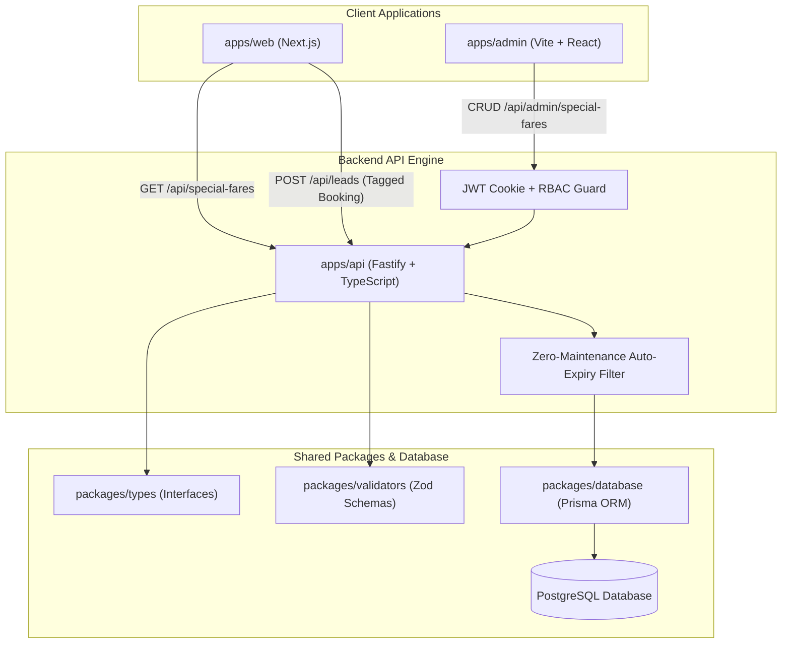

# Flyora Travels — Special Fare Tickets Module Plan

This document details the functional specifications, database models, API interfaces, user experiences, and implementation roadmap for the **Special Fare Tickets (Bulk Flight Deals)** module.

---

## 1. Executive Summary & Business Context

### 1.1 The Business Opportunity

Flyora regularly purchases **Special Fare Tickets** in bulk (contracted group airline allotments, fixed departure blocks, and PNR charter seats) on high-demand international and domestic sectors (e.g. Kozhikode/Mumbai $\leftrightarrow$ Dubai/Jeddah/Doha/London).

- **Core Value Proposition**: 20% to 40% cheaper than open-market GDS airline rates, with guaranteed baggage allowances and fixed departure schedules.
- **Current Bottleneck**: These tickets are currently sold through external third-party reseller panels or manual WhatsApp broadcasts, resulting in lost reseller commissions and scattered customer data.
- **Strategic Goal**: Bring this bulk inventory directly into Flyora's digital platform. Customers browse and reserve available seats via a dedicated `/special-fares` portal and through the homepage Hero flight search bar, funneling high-intent booking leads directly into Flyora's internal CRM lead pool.

---

## 2. Monorepo Architectural Architecture



---

## 3. Core Database Model (`packages/database/prisma/schema.prisma`)

```prisma
enum FlightType {
  NON_STOP
  CONNECTING
}

enum SpecialFareStatus {
  ACTIVE
  SOLD_OUT
  EXPIRED
  PAUSED
}

model SpecialFareTicket {
  id              String            @id @default(uuid())

  // Flight & Route Details
  airlineName     String            // e.g. "Air India Express", "Emirates", "IndiGo", "Saudia"
  airlineCode     String?           // e.g. "IX", "EK", "6E", "SV" (for airline logo display)
  flightNumber    String?           // e.g. "IX-345"
  originCity      String            // e.g. "Kozhikode", "Mumbai", "Delhi"
  originCode      String            // e.g. "CCJ", "BOM", "DEL"
  destinationCity String            // e.g. "Dubai", "Jeddah", "Doha", "London"
  destinationCode String            // e.g. "DXB", "JED", "DOH", "LHR"

  departureDate   DateTime          // Scheduled departure time
  arrivalDate     DateTime?         // Scheduled arrival time
  flightType      FlightType        @default(NON_STOP)
  baggageInfo     String            // e.g. "30 Kg Check-in + 7 Kg Cabin"

  // Inventory & Pricing
  totalSeats      Int               // Total batch quota purchased
  availableSeats  Int               // Remaining seats available for public booking
  farePerSeat     Decimal           @db.Decimal(10, 2) // Selling price per passenger
  supplierCost    Decimal?          @db.Decimal(10, 2) // Staff-only supplier cost
  pnrNumber       String?           // Staff-only airline group PNR reference
  notes           String?           @db.Text           // Internal remarks or conditions

  // Lifecycle & Auto-Expiry
  expiresAt       DateTime          // Exact timestamp when deal stops showing publicly
  status          SpecialFareStatus @default(ACTIVE)
  isActive        Boolean           @default(true)      // Manual visibility switch
  displayOrder    Int               @default(0)

  createdAt       DateTime          @default(now())
  updatedAt       DateTime          @updatedAt

  // Indices for sub-millisecond public query performance
  @@index([isActive, expiresAt, availableSeats])
  @@index([originCode, destinationCode, departureDate])
}
```

---

## 4. Zero-Maintenance Auto-Expiry Logic

1. **Query-Level Enforcement**:
   Every public request to `/api/special-fares` queries:
   ```ts
   where: {
     isActive: true,
     status: "ACTIVE",
     availableSeats: { gt: 0 },
     expiresAt: { gt: new Date() }, // Automatically hides flights past expiration
   }
   ```
2. **Smart Default Expiry on Creation**:
   - When an admin sets `departureDate`, the system suggests `expiresAt = departureDate - 6 hours` (or configurable up to 2 hours before flight).
3. **Visual Urgency Indicators**:
   - `< 24 hours to departure`: Amber pulsing badge (_"Departing Tomorrow · Limited Seats"_).
   - `<= 3 seats left`: Red urgency pill (_"Only X seats left at this price"_).

---

## 5. API Endpoints Specification (`apps/api`)

### 5.1 Public Endpoints (Accessible by `apps/web`)

| Method | Endpoint                         | Query / Payload                                      | Description                                                                           |
| :----- | :------------------------------- | :--------------------------------------------------- | :------------------------------------------------------------------------------------ |
| `GET`  | `/api/special-fares`             | `?from=CCJ&to=DXB&date=2026-11-20&airline=Air+India` | Filterable list of live, non-expired tickets.                                         |
| `GET`  | `/api/special-fares/routes`      | None                                                 | Returns distinct active origin $\rightarrow$ destination pairs for fast filter chips. |
| `GET`  | `/api/special-fares/:id`         | None                                                 | Single ticket details for modal/confirmation.                                         |
| `POST` | `/api/special-fares/:id/enquire` | `{ fullName, phone, email, passengerCount, notes }`  | Automatically records a Lead in `packages/database` tagged `[SPECIAL FARE]`.          |

### 5.2 Admin Endpoints (Protected by JWT & Staff RBAC)

| Method   | Endpoint                              | Allowed Roles                         | Description                                                           |
| :------- | :------------------------------------ | :------------------------------------ | :-------------------------------------------------------------------- |
| `GET`    | `/api/admin/special-fares`            | Super Admin, Ops, Service Coordinator | Paginated list with all statuses (Active, Expired, Sold Out).         |
| `POST`   | `/api/admin/special-fares`            | Super Admin, Ops Manager              | Create new group ticket allotment.                                    |
| `PUT`    | `/api/admin/special-fares/:id`        | Super Admin, Ops Manager              | Update fare, dates, or baggage details.                               |
| `PATCH`  | `/api/admin/special-fares/:id/seats`  | Super Admin, Ops, Coordinator         | Quick increment/decrement of available seats (e.g. after phone sale). |
| `PATCH`  | `/api/admin/special-fares/:id/toggle` | Super Admin, Ops Manager              | Toggle `isActive` on/off immediately.                                 |
| `DELETE` | `/api/admin/special-fares/:id`        | Super Admin                           | Soft-delete or archive ticket record.                                 |

---

## 6. Admin Panel Experience (`apps/admin`)

- **New Navigation Item**: _"Special Fares"_ added to the admin sidebar alongside Tour Packages and Leads.
- **Inventory Overview Dashboard**:
  - Top Metrics: `Active Allotments`, `Seats Remaining`, `Expiring in 24 Hours`, `Total Bookings Generated`.
- **Management Grid**:
  - Route badge (`CCJ` $\to$ `DXB`), Airline logo & flight number.
  - Date & Time countdown until flight departure and deal expiry.
  - Live Seat Widget: `[ - ] 4 / 20 [ + ]` (allows coordinators to adjust available seats with one click).
  - PNR and margin summary (visible only to managers/admins).
- **"Add Special Fare" Drawer**:
  - Airline name & flight number.
  - From & To city/airport selector with airport code auto-detection.
  - Departure and arrival date-time pickers.
  - Baggage policy preset buttons (`20kg`, `30kg`, `40kg`, `7kg Cabin`).
  - Seat count, cost price, and customer selling price.

---

## 7. Public Web Experience (`apps/web`)

### 7.1 Dedicated Special Fares Page (`/special-fares`)

1. **Header Banner**: _"Flyora Exclusive Group Fares & Bulk Departures — Up to 40% Off Regular Airline Prices"_.
2. **Sector Filter Strip**: Instant filter pills (_All Routes_, _Kerala $\to$ UAE_, _Mumbai $\to$ Gulf_, _Delhi $\to$ Europe_, _Umrah Sectors_).
3. **Deal Card Design**:
   - Universal `rounded-[14px]` card border with light shadow.
   - Airline branding, flight timing, duration, and stop info.
   - Baggage allowance badge (`30 Kg Check-in Included`).
   - Comparison pricing: ₹9,499 (Market estimate: ~~₹14,800~~).
   - "Claim This Fare" / "Book Seat" button that launches the prefilled Flyora enquiry modal.

### 7.2 Homepage Hero Search Card Integration (`HeroSearchCard.tsx`)

- When the visitor selects the **Flight Booking** service card in the hero:
  - Add a dynamic toggle pill: **`⚡ Special Group Fares`** vs **`Custom Route Search`**.
  - If active special fare tickets exist for the user's selected sector, a dynamic blue callout card appears:
    > _"🔥 4 Special Fare seats available for Dubai on your dates from ₹9,200 (Saves ₹3,800). [View & Claim Seat →]"_

---

## 8. Phased Implementation Roadmap

```
┌─────────────────────────────────────────────────────────────┐
│ Phase 1: Database & Contracts (Prisma Migration + Zod)      │
└──────────────────────────────┬──────────────────────────────┘
                               │
┌──────────────────────────────▼──────────────────────────────┐
│ Phase 2: Fastify REST API (Public & Admin Routes + Tests)   │
└──────────────────────────────┬──────────────────────────────┘
                               │
┌──────────────────────────────▼──────────────────────────────┐
│ Phase 3: Admin Management UI (CRUD, Seat Counter & Expiry)  │
└──────────────────────────────┬──────────────────────────────┘
                               │
┌──────────────────────────────▼──────────────────────────────┐
│ Phase 4: Public /special-fares Catalog Page & Enquiry Flow   │
└──────────────────────────────┬──────────────────────────────┘
                               │
┌──────────────────────────────▼──────────────────────────────┐
│ Phase 5: Homepage Hero Flight Card Integration & Validation │
└─────────────────────────────────────────────────────────────┘
```

### Verification & Quality Gates

- **Type Safety**: `turbo run type-check` across all packages and apps with 0 errors.
- **Unit & Integration Tests**: Verify auto-expiry filtering and seat adjustments using Vitest/Node test runners.
- **Visual Design Standard**: Strict adherence to the `14px` border radius standard (`rounded-[14px]`) on all public deal cards.
